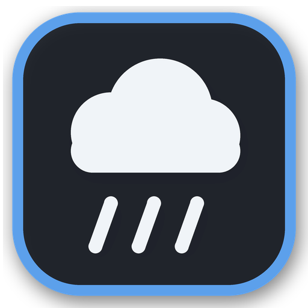
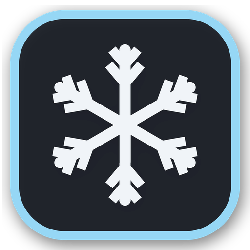
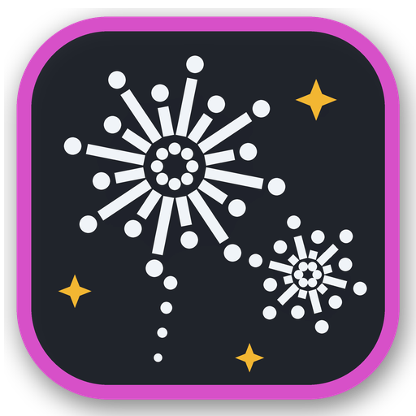

# Variant badges

Small icons in the top-right corner of a Workshop cover image. They show at a glance which variants of a map exist in the Workshop item.

| Badge | Key | Variant | Border |
| :---: | :--- | :--- | :--- |
|  | `day` | Day, the default version | yellow |
|  | `rain` | Rain during the day | blue |
|  | `night` | Clear night | purple |
|  | `night_rain` | Rainy night | blue-purple |
|  | `winter` | Winter, snow | ice blue |
|  | `xmas` | Christmas edition | red |
|  | `night_xmas` | Christmas edition at night | red |
|  | `halloween` | Halloween edition | orange |
|  | `easter` | Easter edition | green |
|  | `lunar_new_year` | Lunar New Year edition | gold |
|  | `new_year` | New Year's Eve edition | magenta |
|  | `summer` | Summer / beach edition (palm tree on an island) | turquoise |

## Rules

- **One badge per map variant.** A variant that combines several things gets a single badge of its own: a rainy night is `night_rain`, not `night` + `rain`. A snowy Christmas map is `xmas`, not `winter` + `xmas`.
- **The default version gets a badge too** (`day`), so the badges always list every map in the item.
- **Order:** the default version first, then the others in the order they were released.
- A new combination (e.g. a snowy night) gets a new badge in the same style: a dark rounded square, a white glyph and a border colour no other badge uses.
- **Night versions of a season badge** keep the season's glyph and border colour and add a small crescent moon in the top-right corner (e.g. `night_xmas`). Make one only when a map has both a day and a night version of that season; otherwise the season badge alone is enough.

## Usage

The badge images (512 px, transparent) are in [`images/badges/`](./images/badges/), for use in an image editor. To stamp them onto a cover image:

```
python3 tools/variant_badges.py stamp cover.png cover_badges.png day,night_rain
```

The badges are scaled to about 11 % of the cover's width, so they stay readable in the small Workshop preview. To regenerate the images after changing a badge:

```
python3 tools/variant_badges.py icons docs/images/badges
```

## Used by

| Map | Badges |
| :--- | :--- |
| `de_dust2_long` | `day`, `night_rain` |
