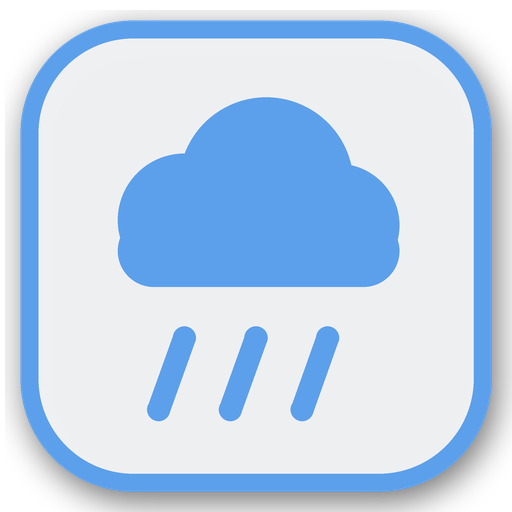
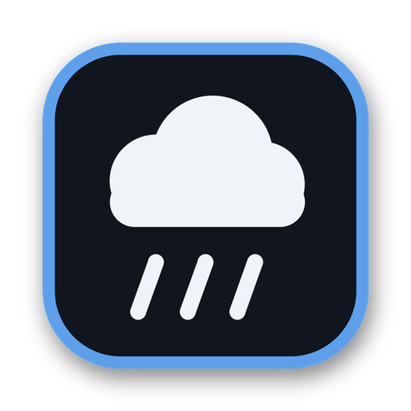
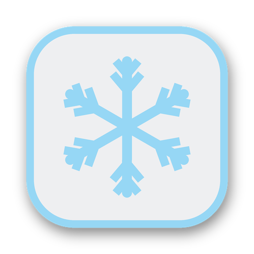
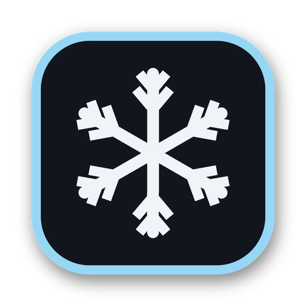

# Variant badges

Small icons in the top-right corner of a Workshop cover image. They show at a glance which variants of a map exist in the Workshop item.

Each badge says two things:
- **the background is the time of day:** light = day, dark = night;
- **the glyph is the weather or the event:** rain, winter, Christmas… For a plain day or night without anything special, the glyph is the sun or the moon.

| Key | Meaning | Day (light) | Night (dark) | Border |
| :--- | :--- | :---: | :---: | :--- |
| `day` | Plain day, the default version |  | – | yellow |
| `night` | Plain night | – |  | purple |
| `rain` | Rain |  |  | blue |
| `winter` | Winter, snow |  |  | ice blue |
| `xmas` | Christmas edition (green tree, gold star) |  |  | red |
| `halloween` | Halloween edition |  |  | orange |
| `easter` | Easter edition |  |  | green |
| `lunar_new_year` | Lunar New Year edition |  |  | gold |
| `night_rain` | Rainy night, the one combined badge (moon behind the rain cloud) | – |  | blue-purple |

On the light (day) background the glyph is drawn in the border colour, on the dark (night) background it is white. The Christmas tree is green and its star gold on both; the Lunar New Year lantern is red and gold on both.

## Rules

- **One badge per map variant.** The background gives the time of day, the glyph the weather or event: a rainy night can be the `rain` glyph on the night background (`rain:night`).
- **The one exception** is `night_rain`, a combined glyph for a rainy night (night only). It is used for Dust II Long (Night) on the cover.
- **An event wins over the weather.** A snowy Halloween map gets the `halloween` glyph, not `winter`.
- **The default version gets a badge too** (`day`, or `night` for a map that is night by default), so the badges always list every map in the item.
- **Order:** the default version first, then the others in the order they were released.
- **A new event or weather** gets a new glyph in the same style (a simple, bold shape) and a border colour no other badge uses. It automatically has a day and a night version.

## Usage

The badge images (512 px, transparent) are in [`images/badges/`](./images/badges/), for use in an image editor. Files are named `badge_<key>_day_512.png` and `badge_<key>_night_512.png` (`badge_day_512.png` and `badge_night_512.png` for the plain day and night). To stamp them onto a cover image:

```
python3 tools/variant_badges.py stamp cover.png cover_badges.png day,night_rain
```

A badge is written as `key` (day) or `key:night` (night).

Each badge is 7.5 % of the cover's width by default, so they stay readable in the small Workshop preview without covering much of the picture. Use `--scale 0.09` (or any other share) to change it. To regenerate the images after changing a badge:

```
python3 tools/variant_badges.py icons docs/images/badges
```

## Used by

| Map | Badges |
| :--- | :--- |
| `de_dust2_long` | `day`, `night_rain` |
